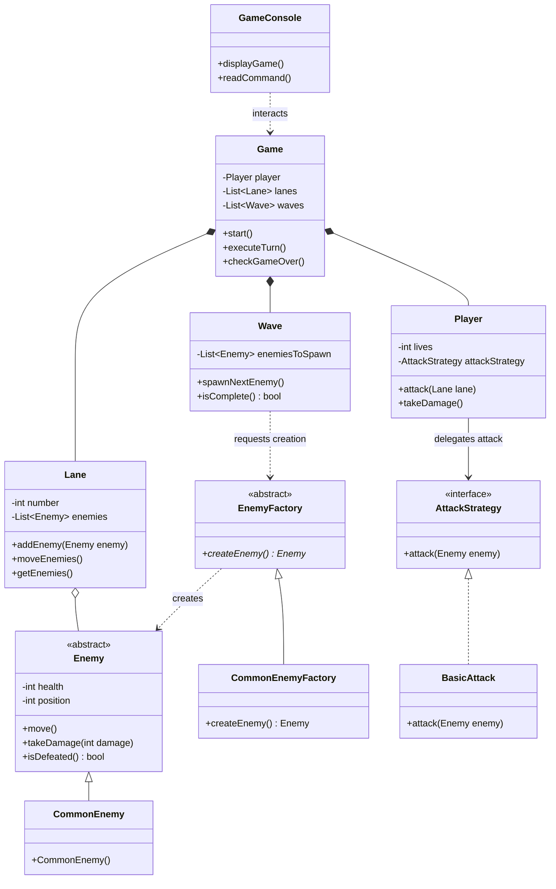
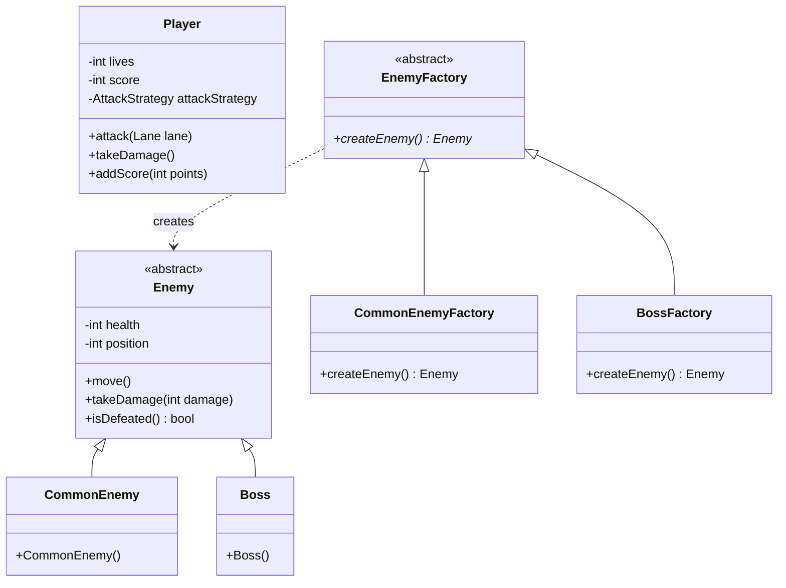

# Lane-Based Combat Game

Projeto acadêmico da disciplina **Design Patterns**, com proposta de desenvolvimento de um jogo de combate por lanes (caminhos), utilizando Java e uma interface de terminal.

> **Status do projeto:** planejamento e padrões iniciais definidos. A UML proposta está documentada abaixo; o diagrama final, a implementação e os testes deverão ser atualizados conforme o desenvolvimento avançar.

## 1. Descrição do projeto

O Lane-Based Combat Game é um jogo por turnos no qual inimigos aparecem em diferentes caminhos e avançam em direção ao personagem do jogador. O objetivo é derrotar os inimigos antes que alcancem o jogador. Para vencer, o jogador deve sobreviver às ondas de inimigos comuns e derrotar um chefão no final.

O projeto será desenvolvido em **Java**, com interação pelo **terminal**, conforme as opções permitidas no enunciado.

## 2. Objetivos

- Desenvolver um jogo funcional com múltiplas lanes e ondas de inimigos.
- Aplicar conceitos de orientação a objetos e Design Patterns de forma justificada.
- Representar a arquitetura do sistema por meio de diagramas UML.
- Implementar pelo menos duas funcionalidades adicionais às descritas no enunciado.
- Documentar as decisões, suposições, padrões utilizados e eventual uso de ferramentas de Inteligência Artificial (IA).

## 3. Escopo e decisões de projeto

O enunciado deixa alguns detalhes em aberto. Para tornar o jogo implementável, foram propostas as seguintes decisões:

| Item | Decisão inicial | Justificativa |
|---|---|---|
| Linguagem | Java | Uma das linguagens permitidas no enunciado e adequada à aplicação de orientação a objetos e Design Patterns. |
| Interface | Terminal | Atende ao requisito de interação textual, sem exigir uma interface gráfica. |
| Modalidade | Trabalho individual | Definição de organização do trabalho. |
| Tipo de combate | Por turnos | Simplifica a interação no terminal, a compreensão das ações e a realização de testes. |
| Número de lanes | 3 | Oferece escolhas estratégicas sem tornar a primeira versão excessivamente complexa. |
| Vida inicial do jogador | 3 pontos de vida | Define uma condição objetiva de derrota e exige que o jogador evite a passagem dos inimigos. |
| Pontuação por inimigo comum | 100 pontos | Recompensa o jogador por cada inimigo comum derrotado. |
| Vida do inimigo comum | 1 ponto de vida | Permite que o ataque básico derrote um inimigo comum em um golpe. |
| Vida do chefão | 5 pontos de vida, equivalente a cinco vezes a vida de um inimigo comum | Torna o confronto final mais longo e diferencia o chefão dos inimigos comuns. |
| Recompensa por derrotar o chefão | 500 pontos | Mantém a recompensa proporcional à resistência proposta para o chefão. |
| Quantidade de ondas comuns | 3 ondas com 3 inimigos por onda | Escopo inicial pequeno e controlado para facilitar a implementação e os testes. |

Os valores e regras desta tabela são decisões de projeto, e não requisitos numéricos expressos no enunciado original. Eles poderão ser ajustados durante a implementação caso testes revelem problemas de equilíbrio ou funcionamento.

## 4. Regras de funcionamento propostas

### 4.1. Estrutura das fases

O jogo será organizado em três ondas de inimigos comuns, seguidas por uma batalha final:

1. **Onda 1:** três inimigos comuns.
2. **Onda 2:** três inimigos comuns.
3. **Onda 3:** três inimigos comuns.
4. **Batalha final:** um chefão com cinco pontos de vida.

Ao todo, a proposta prevê nove inimigos comuns e um chefão. A batalha final será liberada após a conclusão das três ondas comuns.

### 4.2. Lanes e movimentação

- O mapa terá três lanes, identificadas como 1, 2 e 3.
- Cada inimigo estará associado a uma lane.
- Para a versão inicial, está prevista uma distância de seis posições entre a entrada dos inimigos e o jogador.
- Ao final de cada turno, os inimigos vivos avançarão uma posição em direção ao jogador.
- A proposta inicial é introduzir um inimigo por turno, respeitando a sequência da onda.
- Quando um inimigo alcançar a posição do jogador, ele causará a perda de um ponto de vida e será removido do mapa.

A distância de seis posições e a introdução de um inimigo por turno são parâmetros de projeto que serão validados durante a implementação.

### 4.3. Ações de combate

- O jogador poderá escolher uma lane para atacar em cada turno.
- O ataque básico causará um ponto de dano.
- Um inimigo comum possui um ponto de vida e será derrotado com um ataque bem-sucedido.
- O chefão possui cinco pontos de vida e precisará receber cinco ataques bem-sucedidos para ser derrotado, caso o ataque básico continue causando um ponto de dano.
- Atacar uma lane vazia não causará dano nem concederá pontos.
- A movimentação dos inimigos ocorrerá ao final do turno, de acordo com a ordem de ações que será implementada e testada.

### 4.4. Sistema de pontuação

O sistema de pontuação é uma das funcionalidades adicionais escolhidas para o projeto.

- Cada inimigo comum derrotado concede 100 pontos.
- Derrotar o chefão concede 500 pontos.
- Atacar uma lane vazia não concede pontos.
- A pontuação acumulada será exibida ao jogador, inclusive ao final da partida.

Se o jogador derrotar todos os inimigos comuns e o chefão, a pontuação máxima prevista pelas regras atuais será de **1.400 pontos**: 900 pontos pelos nove inimigos comuns e 500 pontos pelo chefão.

### 4.5. Condições de término

**Vitória:** o jogador derrota os nove inimigos comuns, conclui as três ondas e derrota o chefão final. O jogo termina exibindo a pontuação final.

**Derrota:** o jogador perde os três pontos de vida porque inimigos alcançam sua posição. O jogo termina e exibe a pontuação obtida.

## 5. Funcionalidades adicionais

O enunciado solicita pelo menos duas funcionalidades não definidas explicitamente na descrição inicial. Foram selecionadas as seguintes:

### 5.1. Sistema de pontuação

O jogador acumula pontos ao derrotar inimigos. A pontuação permite acompanhar o desempenho durante a partida e acrescenta um objetivo além de sobreviver.

### 5.2. Chefão no final

Após as três ondas comuns, o jogador enfrenta um inimigo final com cinco vezes a vida de um inimigo comum. A batalha final funciona como objetivo de conclusão e diferencia o último confronto dos anteriores.

As duas funcionalidades deverão aparecer na modelagem UML final e ser descritas com mais detalhes após sua implementação.

## 6. Design Patterns selecionados para a UML inicial

Foram selecionados dois padrões para a arquitetura inicial: **Strategy**, aplicado ao ataque do jogador, e **Factory Method**, aplicado à criação de inimigos. A escolha deverá ser confirmada pelo código: o padrão só deverá ser considerado implementado se as classes e os métodos realmente seguirem a estrutura descrita.

### 6.1. Strategy — comportamento de ataque

A interface `AttackStrategy` define uma operação de ataque, enquanto `BasicAttack` implementa o ataque básico que causa um ponto de dano. A classe `Player` mantém uma referência para `AttackStrategy` e delega a ela a execução do ataque, em vez de concentrar a regra diretamente em `Player`.

**Justificativa:** essa separação mantém a lógica de combate independente do gerenciamento de vidas e do restante do estado do jogador. Caso o projeto receba ataques especiais no futuro, poderão ser adicionadas novas implementações da interface sem reescrever a estrutura principal de `Player`. Na versão inicial haverá apenas o ataque básico; portanto, a vantagem imediata é a separação de responsabilidades e a extensibilidade, não a existência de várias opções de ataque já disponíveis.

### 6.2. Factory Method — criação de inimigos

A classe abstrata `EnemyFactory` declara o método `createEnemy()`. A classe `CommonEnemyFactory` implementa esse método para criar `CommonEnemy`. Na evolução do jogo, `BossFactory` poderá implementar o mesmo método para criar `Boss`, mantendo a criação específica de cada tipo separada da lógica que controla as ondas.

**Justificativa:** centralizar a criação dos inimigos evita espalhar pelo jogo os detalhes de instanciação e inicialização de cada tipo. Quando o chefão for incluído na versão com funcionalidades extras, será possível adicionar uma fábrica específica e manter `Game` e `Wave` menos dependentes das classes concretas. A estrutura deve ser mantida simples e corresponder ao uso real no código.

### 6.3. Por que não selecionar outros padrões agora?

`Observer` não será incluído na UML inicial porque, neste momento, não foi identificada uma necessidade concreta de vários componentes reagirem de forma independente a eventos do jogo. Evitar padrões sem uma função clara torna a modelagem mais simples e a justificativa acadêmica mais consistente.

## 7. Modelagem UML

Os diagramas abaixo são **propostas de arquitetura**, não uma afirmação de que o código já foi implementado. Devem ser revisados para corresponder às classes e aos relacionamentos efetivamente desenvolvidos.

### 7.1. UML inicial

A UML inicial apresenta o núcleo do jogo, o padrão Strategy no ataque e a estrutura de Factory Method para criar inimigos comuns.



**Relacionamentos principais:** `Game` coordena `Player`, `Lane` e `Wave`; cada `Lane` mantém os inimigos nela presentes; `Wave` solicita à fábrica a criação de inimigos; `CommonEnemyFactory` concretiza `EnemyFactory`; `CommonEnemy` herda os atributos e comportamentos de `Enemy`; e `Player` delega a execução do ataque à interface `AttackStrategy`, implementada por `BasicAttack`.

### 7.2. Evolução prevista para a UML final

A UML final deverá refletir as duas funcionalidades extras selecionadas: sistema de pontuação e chefão final. Abaixo está a extensão prevista, que deverá ser integrada ao diagrama inicial e validada após a implementação.



No modelo final, `Player` acumulará 100 pontos por inimigo comum derrotado e 500 pontos ao derrotar o chefão. `Boss` terá cinco pontos de vida, enquanto `CommonEnemy` terá um. A implementação deverá assegurar que os pontos sejam concedidos uma única vez por inimigo derrotado. O diagrama final completo também deverá manter os relacionamentos de `Game`, `Lane`, `Wave`, `AttackStrategy`, `BasicAttack` e `GameConsole` apresentados na UML inicial.

Os arquivos de imagem exportados dos diagramas poderão ser colocados em `docs/` e vinculados nesta seção quando estiverem disponíveis.

## 8. Implementação e testes

A implementação será realizada em Java, com comandos e resultados apresentados no terminal. A estrutura de classes e os detalhes do código serão documentados depois que a arquitetura for definida.

Os testes deverão verificar, no mínimo:

- a movimentação dos inimigos pelas lanes;
- a aplicação de dano e a remoção de inimigos derrotados;
- a perda de vida quando um inimigo alcança o jogador;
- a atualização correta da pontuação;
- a progressão entre as três ondas;
- o aparecimento e a derrota do chefão;
- as condições de vitória e derrota;
- o comportamento ao atacar uma lane vazia e ao receber entradas inválidas.

Os resultados dos testes, os comandos necessários para executar o jogo e eventuais requisitos de ambiente serão acrescentados após a implementação.

## 9. Uso de ferramentas de Inteligência Artificial

O enunciado permite o uso de ferramentas de IA, mas exige que o relatório informe em quais partes elas foram utilizadas e qual foi sua contribuição.

Esta seção deverá ser preenchida com o registro real do desenvolvimento, indicando a ferramenta utilizada, a etapa em que foi usada, a contribuição recebida e o que foi revisado ou validado pelo autor. Não se deve declarar uma utilização ou contribuição que não tenha ocorrido.

## 10. Organização prevista do repositório

A estrutura abaixo é uma sugestão inicial e poderá ser ajustada quando os arquivos forem criados:

```text
lane-based-combat-game/
├── README.md
├── src/
│   └── ... arquivos Java ...
├── docs/
│   ├── uml-inicial.png
│   └── uml-final.png
└── ... arquivos de teste, se aplicável ...
```

## 11. Relação com os requisitos do enunciado

| Requisito | Como será atendido | Situação |
|---|---|---|
| Modelagem UML inicial | Diagrama dos principais componentes, responsabilidades, relacionamentos, Strategy e Factory Method | Proposta documentada; revisar após implementar |
| Implementação em Java ou C++ | Jogo em Java com interface de terminal | Planejado |
| Registro do uso de IA | Documentar ferramenta, etapa e contribuição, caso aplicável | A preencher durante o desenvolvimento |
| Duas ou mais funcionalidades extras | Sistema de pontuação e chefão final | Definidas; implementação pendente |
| UML das funcionalidades extras | Extensão do diagrama para refletir a pontuação, o chefão e sua fábrica | Extensão prevista; validar após implementar |
| Relatório único | Este README será atualizado com decisões, padrões, diagramas e implementação | Em andamento |
| Justificativa dos Design Patterns | Strategy separa o comportamento de ataque; Factory Method centraliza a criação de inimigos | Definidos para a UML inicial; confirmar na implementação |
| Decisões e suposições | Registrar as regras propostas nesta documentação e futuras decisões | Em andamento |

## 12. Referência ao enunciado

Este projeto segue o enunciado **“Design Patterns — Lane-Based Combat Game”**, de Pedro Lopes, datado de outubro de 2026. O enunciado solicita um jogo com múltiplas lanes, inimigos que avançam em direção ao personagem, implementação em Java ou C++ com interface de terminal, pelo menos duas funcionalidades extras, modelagem UML inicial e final e um relatório que documente decisões de projeto, Design Patterns e eventual uso de IA.

---

**Observação:** este README registra o planejamento consolidado até o momento. Para funcionar como relatório final de entrega, deverá ser atualizado após a conclusão dos diagramas UML, da escolha definitiva dos padrões, da implementação e dos testes.
