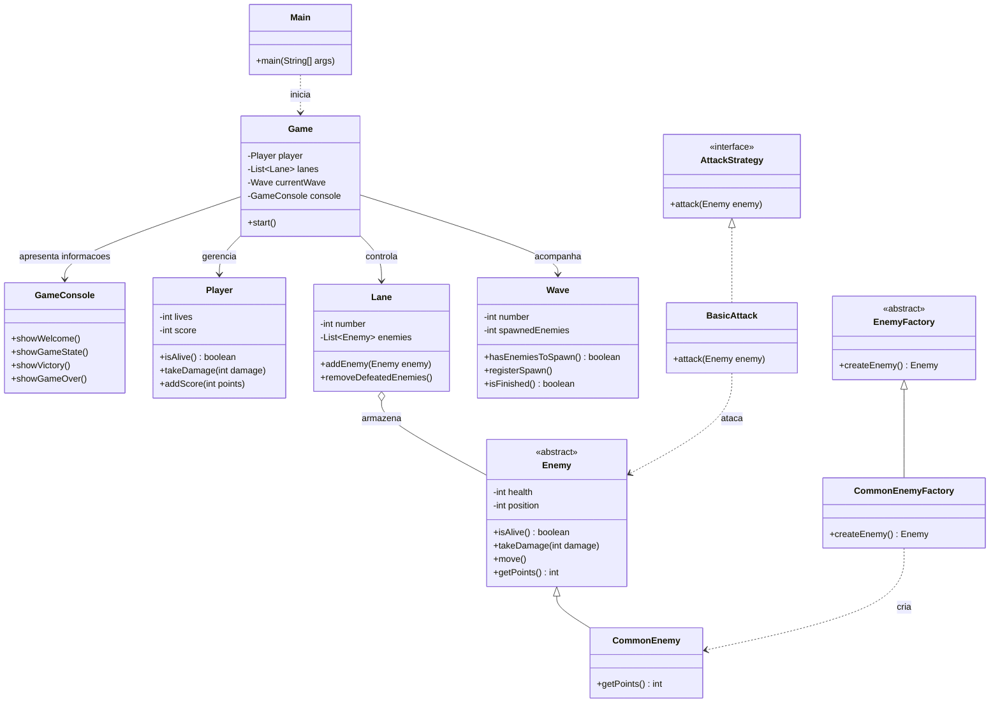
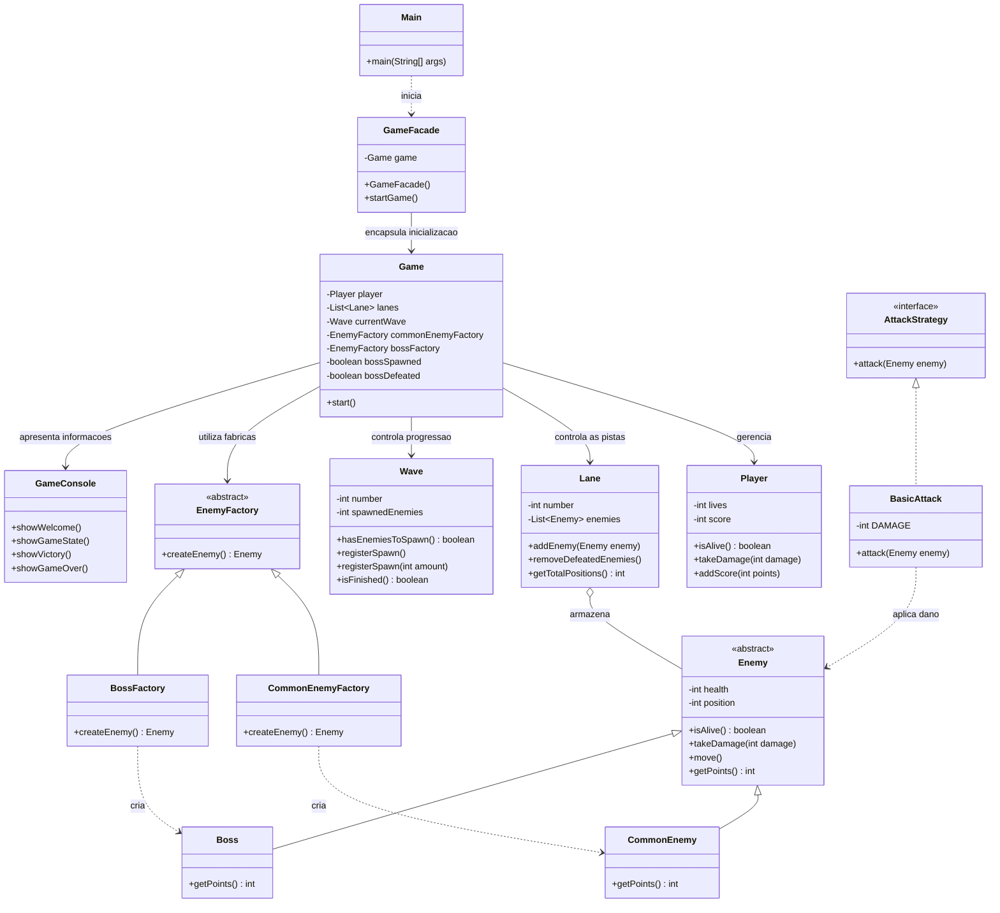

# Lane-Based Combat Game

## 1. Visão geral do projeto

O **Lane-Based Combat Game** é um jogo de combate por turnos desenvolvido em Java, executado no terminal. O jogador precisa defender sua posição contra inimigos que avançam por três pistas (de cima para baixo). A cada turno, é necessário escolher uma pista e atacar os inimigos antes que eles alcancem o jogador.

O jogo foi desenvolvido com foco na aplicação de conceitos de Programação Orientada a Objetos para Engenharia de Software, aplicando conceitos de encapsulamento, herança, abstração e polimorfismo, buscando separar as responsabilidades de gerenciamento da partida, representação dos personagens, criação dos inimigos, execução dos ataques e interação com o usuário.

### Objetivos do projeto

- Desenvolver um jogo funcional executado no terminal em linguagem Java.
- Utilizar caminhos (lanes) pelos quais o jogador atacará a progressão de ondas (waves) de inimigos que se aproximam.
- Criar diagramas utilizando a Unified Modeling Language (UML).
- Utilizar padrões de projetos ( design patterns) soluções reutilizaveis para problemas recorrentes.
- Identificação de uso de ferramentas de Inteligência Artificial (IA) no projeto. 
- Adicionar funcionalidades extras ( sistema de pontuação e chefão final)
- Criar testes automatizados para verificar as principais regras e comportamentos do jogo.

### Tecnologias utilizadas

- **Java 17:** linguagem de programação.
- **Maven:** gerenciamento do projeto, compilação e execução dos testes.
- **JUnit 5:** implementação dos testes automatizados.
- **Mermaid:** representação dos diagramas UML na documentação.

---


## 2. Modelagem UML inicial

A modelagem UML inicial representa a estrutura fundamental planejada para o jogo, antes da incorporação das funcionalidades adicionais. Ela identifica as principais entidades do domínio, suas responsabilidades e as relações necessárias para implementar o combate, o gerenciamento das pistas e a criação dos inimigos.

### Diagrama de classes inicial



A versão inicial estabelece a separação entre o gerenciamento da partida, o jogador, as pistas, os inimigos, as ondas e o combate. Os padrões Strategy e Factory Method permitem, respectivamente, separar o comportamento de ataque e organizar a criação dos inimigos.


## 3. Padrões de projeto utilizados e justificativas

Foram utilizados três padrões de projeto: **Strategy**, **Factory Method** e **Facade**.

### 3.1. Strategy

**Objetivo:** encapsular o comportamento de ataque em uma abstração separada.

No projeto, o padrão é representado por:

- `AttackStrategy`: interface que define o método `attack(Enemy enemy)`.
- `BasicAttack`: implementação concreta da estratégia de ataque.

A classe `BasicAttack` verifica se o inimigo recebido não é nulo e está vivo antes de aplicar um ponto de dano.

Essa separação permite adicionar novos tipos de ataque por meio de implementações de `AttackStrategy`, sem concentrar todos os comportamentos em uma única classe.

**Justificativa:** o padrão foi utilizado para separar a lógica de ataque das demais responsabilidades do jogo, favorecendo a organização, a manutenção e a extensibilidade do combate.

### 3.2. Factory Method

**Objetivo:** centralizar a criação de objetos de inimigos por meio de um contrato comum.

No projeto, o padrão é representado por:

- `EnemyFactory`: classe abstrata que declara o método `createEnemy()`.
- `CommonEnemyFactory`: implementação responsável pela criação de `CommonEnemy`.
- `BossFactory`: implementação responsável pela criação de `Boss`.

As fábricas retornam objetos do tipo abstrato `Enemy`, embora cada implementação produza uma classe concreta diferente.

**Justificativa:** o padrão reduz o acoplamento entre a lógica de gerenciamento da partida e a instanciação dos inimigos. A criação de inimigos comuns e do chefe fica concentrada em classes próprias, facilitando a manutenção e a inclusão de novos tipos de inimigos.

### 3.3. Facade

**Objetivo:** oferecer um ponto de entrada simplificado para iniciar o jogo.

No projeto, `GameFacade` cria uma instância de `Game` e disponibiliza o método `startGame()`. A classe `Main` utiliza essa fachada para iniciar a partida sem instanciar `Game` diretamente.

**Justificativa:** a fachada simplifica a inicialização do jogo e oculta da classe de entrada o detalhe de criação do objeto `Game`. Ela não elimina todas as dependências internas do sistema.

### 3.4. Relação entre os padrões e a arquitetura

Os três padrões atendem a responsabilidades diferentes:

| Padrão | Responsabilidade no projeto | Benefício |
|---|---|---|
| Strategy | Define como um ataque é realizado | Facilita a extensão dos comportamentos de ataque |
| Factory Method | Define como os inimigos são criados | Centraliza a instanciação e reduz o acoplamento |
| Facade | Simplifica a inicialização do jogo | Oculta o detalhe de criação de `Game` da classe `Main` |

A aplicação dos padrões contribui para uma arquitetura mais organizada, separando o comportamento de ataque, a criação de inimigos e o ponto de entrada da aplicação.

---

## 4. Decisões e suposições durante o desenvolvimento

Durante o desenvolvimento, foram adotadas decisões para manter as regras do jogo compreensíveis e permitir a separação entre as entidades do domínio e a lógica responsável pela execução da partida.

### 4.1. Organização das classes

O código foi organizado em pacotes de acordo com a responsabilidade de cada componente:

- `factory`: classes responsáveis pela criação de inimigos.
- `game`: gerenciamento do fluxo da partida.
- `model`: entidades e estruturas fundamentais do jogo.
- `model.enemy`: hierarquia de inimigos.
- `strategy`: contratos e implementações de ataques.
- `ui`: experiência de usuário para interação com o jogador por meio do terminal.

A classe `Main` funciona como ponto de entrada da aplicação.

### 4.2. Separação entre modelo, regras e interface

As entidades do domínio não concentram toda a lógica da aplicação. A classe `Game` coordena a progressão da partida, enquanto `Player`, `Lane`, `Wave` e as classes de inimigos representam elementos específicos do jogo.

A classe `GameConsole` é responsável pela apresentação de informações e pela interação com o usuário no terminal.

Essa separação facilita a manutenção do código e permite testar diferentes partes do sistema de maneira mais isolada, separando as diferentes responsabilidades.

### 4.3. Hierarquia de inimigos

A classe abstrata `Enemy` concentra características compartilhadas, como vida, posição, movimentação e recebimento de dano.

As classes `CommonEnemy` e `Boss` especializam esse comportamento, permitindo que cada tipo de inimigo tenha características próprias, como pontuação e quantidade inicial de vida.

Essa decisão utiliza herança e polimorfismo para evitar a duplicação desnecessária de comportamentos comuns.

### 4.4. Regras de combate e progressão

O jogo foi estruturado em torno de três pistas e três ondas de inimigos comuns. Cada onda prevê o surgimento de dez inimigos comuns, totalizando trinta inimigos comuns nas ondas regulares.

O jogador começa com três vidas. Os inimigos avançam pelas pistas, e aqueles que alcançam a posição do jogador causam dano e são removidos da pista.

A progressão depende do controle das ondas e dos inimigos ainda presentes na partida. O chefe final só aparece quando os trinta inimigos comuns das ondas regulares tiverem sido resolvidos e as pistas estiverem livres.

### 4.5. Pontuação

A pontuação é concedida de acordo com o tipo de inimigo derrotado:

- Inimigo comum: 100 pontos.
- Chefe final: 500 pontos.

A pontuação é armazenada no jogador e atualizada durante a partida.

### 4.6. Condições de vitória e derrota

--> A derrota acontece quando o jogador perde todas as vidas disponíveis.

--> A vitória acontece quando o chefe final é derrotado, desde que o jogador ainda esteja vivo.

Essas condições determinam o encerramento da partida e a apresentação do resultado final.

---

## 5. Funcionalidades adicionais implementadas

Além da estrutura básica de combate, foram implementadas funcionalidades que ampliam a progressão e o desafio do jogo.

### 5.1. Progressão por três ondas

A partida possui três ondas regulares, com dez inimigos comuns previstos em cada uma. A classe `Wave` controla a quantidade de inimigos gerados e permite verificar se ainda existem inimigos a serem gerados e se a onda terminou.

### 5.2. Movimentação dos inimigos

Os inimigos possuem uma posição que avança ao longo da pista. Quando um inimigo alcança o jogador, ocorre a perda de uma vida e a remoção daquele inimigo da pista.

Essa mecânica obriga o jogador a equilibrar a escolha das pistas e a prioridade dos ataques.

### 5.3. Pontuação por inimigo derrotado

A pontuação é atualizada conforme os inimigos são derrotados. Inimigos comuns concedem 100 pontos, enquanto o chefe final concede 500 pontos.

A regra permite acompanhar o desempenho do jogador durante a partida.

### 5.4. Chefe final

Após a resolução dos inimigos das três ondas regulares e quando não há mais inimigos ocupando as pistas, o jogo inicia o confronto final.

O chefe possui três pontos de vida e aparece na pista central acompanhado de inimigos de apoio. Sua derrota encerra a partida com vitória, desde que o jogador permaneça vivo.

### 5.5. Inimigos de apoio do chefe

A batalha final inclui quatro inimigos comuns de apoio: dois em cada uma das pistas laterais. O chefe permanece na pista central.

Essa formação adiciona um desafio à etapa final, pois o jogador precisa alcançar o chefe e lidar ao mesmo tempo com os inimigos de apoio.

### 5.6. Interface de terminal

A classe `GameConsole` apresenta as informações da partida, incluindo o estado das pistas, a situação do jogador e a pontuação. Também apresenta mensagens relacionadas aos ataques, à movimentação dos inimigos e ao encerramento do jogo.


## 6. Modelagem UML final — versão atualizada

A versão atualizada da modelagem UML representa a arquitetura após a incorporação das funcionalidades adicionais. Em relação ao modelo inicial, foram incluídos o chefe final, sua fábrica específica, os mecanismos de progressão e encerramento da partida, a interface de terminal e a fachada responsável por simplificar o ponto de entrada da aplicação.

### Diagrama de classes final



A versão final evidencia a evolução da arquitetura: a classe `Boss` especializa `Enemy`, enquanto `BossFactory` centraliza sua criação. A classe `Game` coordena as pistas, o jogador, as ondas, as fábricas e a interface de terminal. A classe `GameFacade` fornece uma entrada simplificada para iniciar a partida, sendo utilizada pela classe `Main`.

A comparação entre os diagramas permite identificar as novas classes, as relações adicionadas e a evolução das responsabilidades. Os diagramas representam as principais classes e relações do projeto, sem pretender reproduzir todos os detalhes da implementação.

---

## 7. Uso de ferramentas de inteligência artificial

Durante o desenvolvimento, o ChatGPT foi utilizado como ferramenta de apoio para discutir a organização e estruturação do código, investigar problemas encontrados durante a implementação e organizar os testes automatizados.

O uso da inteligência artificial teve caráter de apoio ao desenvolvimento do sistema. A responsabilidade pela compreensão, revisão e entrega final do projeto permanece com a autora.

---

## 8. Testes automatizados e divisão dos 30 testes

Os testes automatizados foram desenvolvidos com JUnit 5, framework utilizado para definir e executar os casos de teste por meio de recursos como @Test e Assertions. O Maven, aqui foi utilizado para executar a suíte de testes por meio do plugin Surefire.  estão organizados em quatro classes, separadas de acordo com as principais responsabilidades do sistema.

A suíte foi executada com o comando:

```bash
mvn clean test
```

O resultado registrado foi:

```text
Tests run: 30, Failures: 0, Errors: 0, Skipped: 0
BUILD SUCCESS
```

### 8.1. Distribuição dos testes

| Classe de teste | Quantidade | Responsabilidade principal |
|---|---:|---|
| `CombatTest` | 7 | Verificar dano de ataques, vida dos inimigos, derrota e pontuação |
| `GameTest` | 11 | Verificar regras gerais da partida, ataques, pontuação, dano ao jogador e chefe final |
| `LaneTest` | 6 | Verificar criação de pistas, armazenamento, movimentação e remoção de inimigos |
| `ProgressionTest` | 6 | Verificar a geração e o encerramento das ondas |
| **Total** | **30** | **Validação automatizada das principais regras do jogo** |

### 8.2. Testes de combate — `CombatTest`

Os sete testes dessa classe verificam comportamentos relacionados ao combate:

- Derrota de um inimigo comum após receber um ataque.
- Vida inicial do chefe.
- Redução da vida do chefe a cada ataque.
- Derrota do chefe após receber três ataques.
- Pontuação concedida pela derrota de um inimigo comum.
- Pontuação concedida pela derrota do chefe.
- Comportamento do ataque quando a pista não possui inimigos.

### 8.3. Testes do jogo — `GameTest`

Os onze testes dessa classe verificam o funcionamento integrado das regras da partida:

- Inicialização do jogador com três vidas.
- Criação das três pistas vazias.
- Inicialização na primeira onda.
- Derrota de inimigo comum e concessão de pontos.
- Ausência de pontuação ao atacar uma pista vazia.
- Ausência de pontuação ao selecionar uma pista inválida.
- Prioridade do inimigo mais próximo do jogador durante o ataque.
- Atualização da contagem de inimigos derrotados ou resolvidos.
- Derrota do chefe, concessão de pontos e atualização do estado da partida.
- Dano ao jogador e remoção de um inimigo que alcança sua posição.
- Formação do confronto final com o chefe na pista central e quatro inimigos de apoio.

### 8.4. Testes das pistas — `LaneTest`

Os seis testes dessa classe verificam o gerenciamento dos inimigos nas pistas:

- Criação de uma pista inicialmente vazia.
- Adição de um inimigo à pista.
- Avanço da posição do inimigo.
- Remoção de inimigos derrotados.
- Identificação e remoção de um inimigo que alcança o jogador.
- Rejeição de números de pista inválidos.

### 8.5. Testes de progressão — `ProgressionTest`

Os seis testes dessa classe verificam o controle das ondas:

- Inicialização da onda com o número correto.
- Inicialização da contagem de inimigos gerados.
- Geração de dez inimigos previstos para a onda.
- Impedimento de geração acima do limite da onda.
- Criação do tipo esperado de inimigo comum.
- Atualização da conclusão da onda após o registro da geração de dez inimigos.

### 8.6. Resultado da validação

A execução de `mvn clean test` confirmou que os trinta testes foram executados sem falhas, erros ou testes ignorados.

Esse resultado demonstra que os cenários cobertos pela suíte automatizada estão passando na versão testada do projeto.

---

## 9. Como executar o projeto

### Pré-requisitos

- Java Development Kit (JDK) 17 ou compatível.
- Apache Maven instalado e disponível no terminal.

### Compilar o projeto

Na raiz do repositório, execute:

```bash
mvn clean compile
```

### Executar os testes

```bash
mvn clean test
```

### Gerar o pacote

```bash
mvn package
```

### Iniciar o jogo

Após a compilação bem-sucedida, execute:

```bash
java -cp target/classes com.lanebasedcombat.Main
```

O jogo será iniciado no terminal, onde o usuário poderá acompanhar a partida e interagir conforme as instruções apresentadas pela interface.

---

## 10. Estrutura do projeto

```text
lane-based-combat-game/
├── src/
│   ├── main/
│   │   └── java/
│   │       └── com/
│   │           └── lanebasedcombat/
│   │               ├── Main.java
│   │               ├── factory/
│   │               │   ├── EnemyFactory.java
│   │               │   ├── CommonEnemyFactory.java
│   │               │   └── BossFactory.java
|   |               ├── facade/
│   |               |   └── GameFacade.java
│   │               ├── game/
│   │               │   └── Game.java
│   │               ├── model/
│   │               │   ├── Lane.java
│   │               │   ├── Player.java
│   │               │   ├── Wave.java
│   │               │   └── enemy/
│   │               │       ├── Enemy.java
│   │               │       ├── CommonEnemy.java
│   │               │       └── Boss.java
│   │               ├── strategy/
│   │               │   ├── AttackStrategy.java
│   │               │   └── BasicAttack.java
│   │               └── ui/
│   │                   └── GameConsole.java
│   └── test/
│       └── java/
│           └── com/
│               └── lanebasedcombat/
│                   ├── combat/
│                   │   └── CombatTest.java
│                   ├── game/
│                   │   └── GameTest.java
│                   ├── model/
│                   │   └── LaneTest.java
│                   └── progression/
│                       └── ProgressionTest.java
├── pom.xml
└── README.md
```


## FIM
